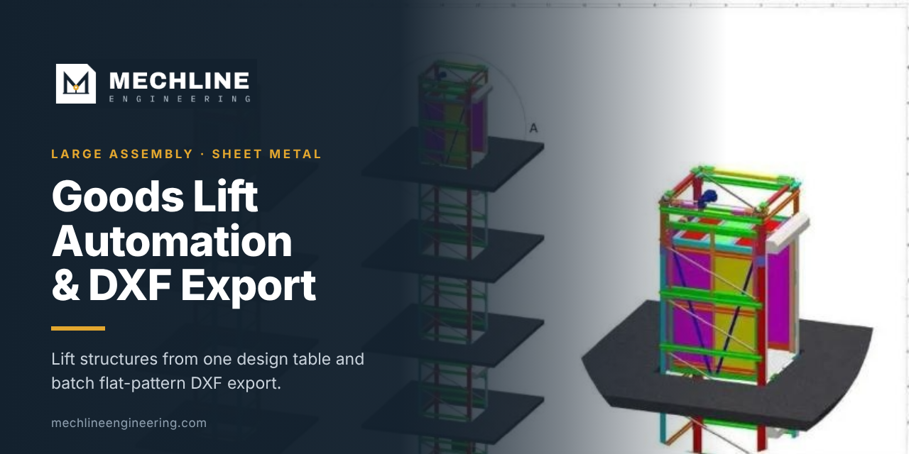

# Goods Lift Automation and Batch DXF Export for SolidWorks

Two SolidWorks automations for large assemblies and sheet-metal production:

1. **Goods lift configurator:** shaft height, floor count and door sizes are driven from one design table, and a VBA macro builds and updates the configured assembly.
2. **Sheet-metal DXF export tool:** batch flat-pattern export to DXF, with bend correction and file-naming rules, ready for laser cutting.

## 1. Goods lift: large-assembly design table

A goods lift changes with every building: the shaft height, the number of floors and the door openings. Instead of remodelling the shaft for each project, one table drives the whole structure.

| Shaft structure and levels | Large-assembly macro |
|---|---|
|  |  |

- **Inputs:** shaft height, floor count and door sizes, all in one table
- **Output:** the lift shaft steelwork is regenerated for the new configuration, ready for drawings

## 2. Sheet-metal DXF export tool

- Exports flat patterns for every sheet-metal part in an assembly in one run
- Applies bend correction
- Names the output files by fixed rules, so the laser shop gets a clean, consistent set
- Removes the manual step of opening every part and saving each flat pattern by hand

## Built with

| | |
|---|---|
| CAD | SolidWorks large assemblies, weldments and sheet metal |
| Automation | SolidWorks API, VBA |
| Data | Excel design tables |
| Output | Configured assemblies and DXF flat patterns |

## Source code

This repository is a showcase. The macros were built for production use, so the source is not public.

**Building lifts, platforms, enclosures or sheet-metal products in many variants?** We can automate your models and your DXF output the same way.

## Contact

**Mechline Engineering** – mechanical design, FEA and contract manufacturing for manufacturers in the US, Europe and Australia.

- Website: https://www.mechlineengineering.com
- Quote request: https://www.mechlineengineering.com/#quote
- Email: info@mechlineengineering.com
- More automation projects: https://github.com/mechline-engineering
